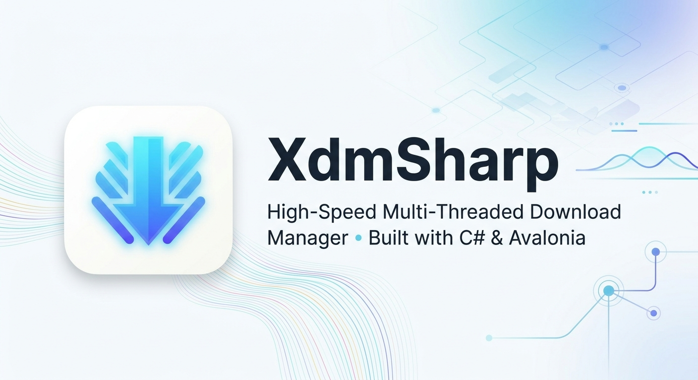

<p align="center">
  
</p>

# XdmSharp

Windows 桌面多线程下载工具（HTTP/HTTPS 分段下载 + 断点续传），C# + MewUI（Win32 + Direct2D）+ .NET 10。

## 特性

- **多段并发**：同一条链接切多个 Range 段并行下载，段数可配（默认 8），动态切分补位
- **断点续传**：任务与段表都落 `xdm.db`（暂停/失败立即写、运行中 30s），进程被杀也能接着下
- **任务库**：任务、分段、用户配置都在同一个 `xdm.db`（PureDb），绿色版目录即数据
- **限速 / 代理 / 队列**：全局并发闸门、限速令牌桶、系统/自定义代理（可多套，按任务选）
- **HuggingFace 模型下载**：输入 `owner/name` → 拉仓库文件清单 → 勾选入队；一个模型包在列表里只占一行
  （进度/速度/状态按文件汇总），子目录原样保留，LFS 文件下发前校验 sha256
- **默认目录**：走 `SHGetKnownFolderPath(FOLDERID_Downloads)`，用户把「下载」搬到别的盘也跟着走
- **原生单文件**：可发布 NativeAOT 档（`build.ps1 -Aot`），15 MB 单 exe，目标机零依赖

## 项目背景

- 参考实现：`refcode/xdm-master`（XDM，Kotlin / Swing / GPL-3.0-or-later）
- 已安装的参考程序：`D:\network\XDM\xdm-app.exe`（v9.0.11，jpackage + JDK 25；数据目录
  `%LOCALAPPDATA%\xdm-app`，日志在 `logs/`）—— 行为/文案/布局有疑问时直接开它对照
- 本项目许可：GPL-3.0（见根目录 `LICENSE`），属参考实现的衍生作品
- 首期范围：普通 HTTP/HTTPS 文件下载（多段并发 + 断点续传 + 限速 + 队列）
- 当前进度：首期 HTTP 已可用，**V2 HF（HuggingFace）模型下载已落地第一版**（无父任务汇总）；
  下一步 **V3 BT / 磁力下载**（架构预留见 `docs/ARCHITECTURE.md` §12）
- 暂**不含**：BT、视频嗅探、HLS/DASH、浏览器扩展、媒体转封装

## 命名约定

| 项 | 值 |
|---|---|
| 仓库目录 | `F:\code\XdmSharp`（不变） |
| 解决方案 | `XdmSharp.sln` |
| 工程 / 程序集 | `Xdm.Core`、`Xdm.Ui.Shared`、`Xdm.Ui.Mew`、`Xdm.App.Mew`、`Xdm.Core.Tests`、`Xdm.Ui.Mew.Tests` |
| 产物 | `xdm.exe`（`AssemblyName` 与工程名解耦：工程带 `.Mew` 是为了指明启动栈） |
| 命名空间根 | **`Xdm`**（如 `Xdm.Core.Http`、`Xdm.Ui.Mew`、`Xdm.App.Mew`） |
| 视图 | 纯 C# code-first（无 XAML），`src/Xdm.Ui.Mew/` |

## 渲染栈：MewUI（Win32 + Direct2D）

界面是 [`Aprillz.MewUI`](https://www.nuget.org/packages/Aprillz.MewUI.Core) 0.22（纯托管、
code-first，没有 XAML 与资源字典），Windows 平台层 + Direct2D 后端。工程只引三个包：

```xml
<PackageReference Include="Aprillz.MewUI.Core" />          <!-- 视图层 Xdm.Ui.Mew -->
<PackageReference Include="Aprillz.MewUI.Platform.Win32" /> <!-- 壳 Xdm.App.Mew -->
<PackageReference Include="Aprillz.MewUI.Backend.Direct2D" />
```

启动链固定在 `src/Xdm.App.Mew/Program.cs`：`Win32Platform.Register()` +
`Direct2DBackend.Register()` → `Application.Run(window)`。

不引 `Aprillz.MewUI.Windows` meta 包：它会把 Gdi / MewVG 后端一起拖进产物（多约 550 KB），
本项目只用 Direct2D。约束与踩坑见 `docs/ARCHITECTURE.md` §2.1 / `docs/PLAN-MEWUI.md`。
2026-11-22 之前的 Avalonia 前端（`Xdm.App` / `Xdm.Ui` / `Xdm.Ui.Tests`）已删除，
历史记录留在 `docs/PROGRESS.md`。

## 技术栈

| 项 | 版本 | 首期 | 说明 |
|---|---|---|---|
| .NET | `net10.0` | ✔ | TFM 不写 `-windows`；`RuntimeIdentifier` 只在 `dotnet publish -r win-x64` 时给 |
| Aprillz.MewUI | `0.22.1` | ✔ | 视图 + 平台 + Direct2D 后端；0.x 次版本间可能破坏性变更，锁死版本升级当独立任务 |
| xunit.v3 | `3.2.2` | ✔ | 测试（含视图层测试） |
| PureDb | `1.0.0-rc.1` | ✔ | 任务库（纯托管嵌入式，无原生依赖；仅 net10.0） |

以上版本本机 NuGet 缓存（`E:\program\nuget\cache`）均已存在，可离线还原。

## 数据文件

任务是**绿色版**布局：任务库与 exe 同目录。

| 文件 | 位置 | 说明 |
|---|---|---|
| `xdm.db` | `AppContext.BaseDirectory\xdm.db` | PureDb 任务库：`tasks` / `segments` / **`settings`**（用户配置也在这，一份一行）。旁边有 `xdm.db.lock`（访问锁），写入量上去后还会生成 `xdm.db.pidx`（页索引），备份/迁移要一起拷 |
| `state/<id>.json` | 同目录 `state/` | 分段进度快照（见 `ARCHITECTURE.md` §7.2） |
| `.<id>.xdm-part` | 任务的目标目录 | 未完成的临时文件（点前缀 + `.xdm-part`，与参考实现一致），发布时原子改名 |

配置**不写 json 文件**：限速/代理/并发/段数/默认目录等都在 `xdm.db` 的 `settings` 表里，
和任务一起备份、一起搬家。旧版留下的 `settings.json` 会在库里还没有配置时导入一次并删除。

exe 目录不可写（装在 `Program Files`、只读介质）时自动回退到 `%LOCALAPPDATA%\Xdm\`，不弹窗阻断。

库位置可以用命令行覆盖（`state\` 始终跟着库文件所在目录走）：

```powershell
.\xdm.exe                                  # 默认：exe 同目录 xdm.db
.\xdm.exe --db D:\XdmData\xdm.db           # 指定库文件；state\ 落在 D:\XdmData\state\
.\xdm.exe https://example.com/a.bin        # 直接弹「新建下载」并预填链接
dotnet run --project src/Xdm.App.Mew -- --db .\dev.db   # 开发期放仓库根，不污染 bin/
```

优先级：`--db <path>` > `XDM_DB` > `XDM_DATA_DIR`（目录语义）> exe 同目录 > `%LOCALAPPDATA%\Xdm\`。
`--db` 指向已存在的目录或缺少取值时直接报错退出（返回码 2）；库文件打不开（权限/磁盘）返回码 3，
不会静默回退或空表启动 —— 免得对着错误的库排查。

同一个库只跑一个进程：再点一次 exe（或浏览器把链接丢过来）时，第二个进程把链接经命名管道
交给已运行的窗口、自己退出（返回码 0；交接失败返回 4 并弹提示）。键按库路径哈希，
不同 `--db` 的实例可并存。细节见 `ARCHITECTURE.md` §7.3。

## 工程结构

```
XdmSharp.sln
global.json                    SDK 固定 10.0.101
Directory.Build.props          统一 TFM / Nullable / TreatWarningsAsErrors
Directory.Packages.props       中央包版本管理
build.ps1                      build [-Test] [-Publish] [-Aot] 快捷脚本
logo.png                       品牌图（图标源文件，改动后跑 tools/make-icons.ps1 重新生成资源）
banner.jpg                     README 顶部 banner
tools/make-icons.ps1           logo.png → xdm-logo.png（透明底）+ xdm.ico（十帧，同透明底）
src/
  Xdm.Core/                    下载引擎、HTTP 客户端、存储、任务库（不依赖 UI）
    Configuration/AppPaths.cs  --db / 环境变量 / 目录回退的路径解析
    Configuration/DbSettingsStore.cs  设置存库（settings 表）+ 旧 settings.json 迁移
    Errors/DownloadError.cs    协议无关的失败原因 + 中文文案
    Http/                      RangeHttpClient（自跟重定向、状态码→SourceOutcome）、请求/响应模型
    Storage/PartFile.cs        未完成文件：单句柄 + 偏移写（多段并发无需锁）
    Storage/AtomicJson.cs      .tmp → fsync → rename 的原子 JSON
    Storage/FileNaming.cs      Content-Disposition / URL → 文件名，非法字符与重名
    Storage/NameConflictPolicy.cs 发布重名策略（自动改名 / 覆盖 / 失败）
    Storage/SegmentVerifier.cs SHA256 校验挂点（V2 LFS / V3 piece）
    HuggingFace/               HfRepo / HfFile（清单）/ HfHubClient（tree API）/ HfDownloadPlanner（落盘计划）
    Tasks/TaskStore.cs         PureDb 任务库（建表、CRUD、启动恢复）
    Tasks/StoredTask.cs        任务行 DTO（含 kind/parent_id/段快照等预留字段）
    Scheduling/DownloadQueue.cs FIFO 待启动队列（并发闸门在管理器）
    Downloads/DownloadEngine.cs  探测 → 等分建段 → 段线程 → 发布；暂停/恢复/删除
    Downloads/DownloadManager.cs 任务表 + 全局闸门（默认 3）+ 调度线程 + 快照事件 + 任务库落盘
    Downloads/DownloadRequest.cs 新建下载入参（URL / 目录 / 文件名 / 段数 / 是否立即开始）
    Downloads/SegmentRunner.cs   单段 Range 循环：fsync 水位、退避重试、断流续写
    Downloads/                  Segment / DownloadTask / DownloadState / ProgressTracker
                                DownloadStatus（状态枚举）、DownloadRecord（不可变视图数据）
  Xdm.Ui.Shared/               视图无关层：ViewModel / 格式化 / 动作接口（不引任何 UI 框架）
    ViewModels/                 MainWindow / DownloadRow / Category / NewDownload + ViewModelBase/RelayCommand
    Formatting/TextFormat.cs    字节 / 速度 / 剩余时间 / 百分比的唯一文案入口
    Services/IDownloadActions.cs 界面命令到引擎的出口（壳实现，测试可注入假实现）
    Samples/SampleDownloads.cs  假数据（`XDM_DEMO=1000` 时启用，虚拟化压测用）
  Xdm.Ui.Mew/                  MewUI 视图（code-first，Win32 + Direct2D；见 docs/PLAN-MEWUI.md）
    MewTheme.cs                配色/尺寸唯一来源（无 XAML 资源字典）
    MainWindow.cs              主窗口：自绘标题栏 + 工具栏 + 分类 + 列表 + 状态栏
    MewCommandBridge.cs        ICommand → MewUI Command（注册进窗口 CommandScope）
    Controls/                  EditBox（中文右键菜单）、SegmentBar、TitleBarChrome（对话框标题栏）
    Dialogs/                   新建下载 / 设置 / 关于 / 确认框
    Assets/xdm-logo.png        标题栏 logo（透明底，由根目录 logo.png 处理而来）
  Xdm.App.Mew/                 MewUI 壳：Win32Platform + Direct2DBackend 注册 + Application.Run
    MewRuntime.cs              组合根：AppPaths → TaskStore → DbSettingsStore → DownloadManager → ViewModel
    MewDownloadBridge.cs       引擎事件 → UI 线程（结构变化立即投递，进度 4Hz 合并）
    MewDownloadActions.cs      IDownloadActions → DownloadManager
    Shell.cs                   打开目录等系统调用
    Assets/xdm.ico             资源管理器 / 任务栏图标
tests/
  Xdm.Core.Tests/              引擎单测 + 自建 TCP 级假 HTTP 服务器（Fakes/FakeHttpServer）
  Xdm.Ui.Mew.Tests/            MewUI 视图层测试（结构/命令桥/对话框/主题/布局，80 条）
artifacts/                     手工冒烟截图（m1-main.png 等，不入库）
docs/
  PLAN.md                      总体计划、里程碑（界面优先）
  ARCHITECTURE.md              分层、类设计、渲染后端切换口、Kotlin→C# 对照
  UI-DESIGN.md                 窗口清单、列表行规范、交互
  TESTING.md                   测试策略与 Headless 配置
  PROGRESS.md                  进度台账
refcode/xdm-master/            参考实现（只读，勿改）
```

拆出 `Xdm.Ui.Mew` 而不是把视图塞进壳：界面测试工程可以只依赖视图层、不拖入平台与后端注册；
平台注册（`Win32Platform.Register` / `Direct2DBackend.Register`）只允许出现在壳里。详见 `docs/TESTING.md`。

再拆出 `Xdm.Ui.Shared`（ViewModel / 文案 / 动作接口，零 UI 框架依赖）：换 UI 框架时这一层零改动，
这也是 2026-11-22 从 Avalonia 换到 MewUI 时业务代码没动的直接原因。
MewUI 的实现约束与踩坑记录见 `docs/PLAN-MEWUI.md`，分层边界见 `docs/ARCHITECTURE.md §1`。

```powershell
dotnet run --project src/Xdm.App.Mew              # 唯一前端（code-first，AOT 产物 ~15 MB）
XDM_DEMO=3 dotnet run --project src/Xdm.App.Mew   # 演示模式：假数据，不建库
```

## 后续协议扩展（现在不做，但形状已留）

| 阶段 | 内容 | 复用 / 新增 |
|---|---|---|
| V2 | HF 模型下载：仓库清单 + 多文件 + LFS sha256 + 镜像/Token | 复用 HTTP 分段引擎；新增 `Xdm.Core.HuggingFace`（Hub 解析、文件编排） |
| V3 | BT / 磁力：peer swarm + piece 校验 | 复用 `PartFile` / 限速 / 任务库 / UI；**独立 `TorrentEngine`** |

首期已经落地的预留点：`TaskKind` + `parent_id`（两级任务）、`SourceOutcome`（协议无关的连接结果）、
`SegmentVerifier`（piece/LFS 校验挂点）、`tasks.content_sha256` / `source_meta_json` 字段。
细节与"违反就返工"的 6 条契约见 `docs/ARCHITECTURE.md` §12.1。

## 常用命令

```powershell
dotnet restore
dotnet build                                  # 或 .\build.ps1
dotnet run --project src/Xdm.App.Mew -- --db .\dev.db
dotnet run --project src/Xdm.App.Mew -- https://example.com/a.bin   # 直接弹「新建下载」并预填
$env:XDM_DEMO=1000; dotnet run --project src/Xdm.App.Mew   # 1000 条假数据，复验列表虚拟化
# 同一任务库只允许一个进程：已有实例在跑时，第二个进程把链接交给它后自己退出（退出码 0）
# 键按库路径哈希计算，所以不同 --db 的两个实例可以并存（多配置并行下载）
dotnet test                                   # 全部测试（321 条：Core 235 + Ui.Mew 86）
dotnet test tests/Xdm.Ui.Mew.Tests            # 视图层测试（结构/命令桥/对话框/布局）
pwsh tools/make-icons.ps1                     # 改了 logo.png 后重生成 xdm-logo.png / xdm.ico
.\build.ps1 -Configuration Release -Test -Publish   # ①构建 ②测试 ③发布 win-x64
.\build.ps1 -Configuration Release -Aot             # NativeAOT 发布到 publish\win-x64-aot

# 普通发布：publish\win-x64\xdm.exe（目录 + 托管 dll，约 4MB，framework-dependent）
# 目标机需 .NET 10 运行时；是否改 self-contained 见 docs/PROGRESS.md 待决事项
# AOT 发布：publish\win-x64-aot\xdm.exe（单个原生 exe，约 15MB，目标机不需要运行时）
#   - 需要 MSVC 链接器 + Windows SDK（VS「使用 C++ 的桌面开发」）
#   - 目录里只有 exe；原生符号 xdm.pdb（~118MB）默认删除，排障加 -KeepAotSymbols
```

## 文档

| 文档 | 内容 |
|---|---|
| [docs/PLAN.md](docs/PLAN.md) | 总体原则、首期范围、里程碑、验收、风险、工作量 |
| [docs/ARCHITECTURE.md](docs/ARCHITECTURE.md) | 分层依赖、Core 类设计、线程模型、持久化格式、UI↔引擎边界、MewUI 渲染栈与单实例、HF/BT 扩展预留（§12） |
| [docs/UI-DESIGN.md](docs/UI-DESIGN.md) | 界面结构与视觉规范（视觉为准，实现以 MewUI 为准，见 §12） |
| [docs/TESTING.md](docs/TESTING.md) | 引擎测试矩阵、MewUI 视图层测试做法与限制 |
| [docs/PLAN-MEWUI.md](docs/PLAN-MEWUI.md) | MewUI 迁移计划与踩坑记录（已完成，历史归档） |
| [docs/PROGRESS.md](docs/PROGRESS.md) | 里程碑进度与验证记录 |
